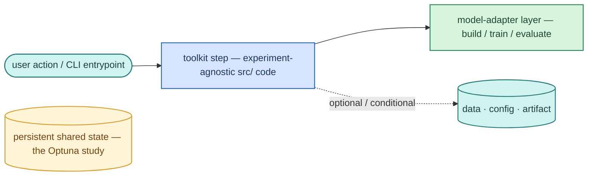
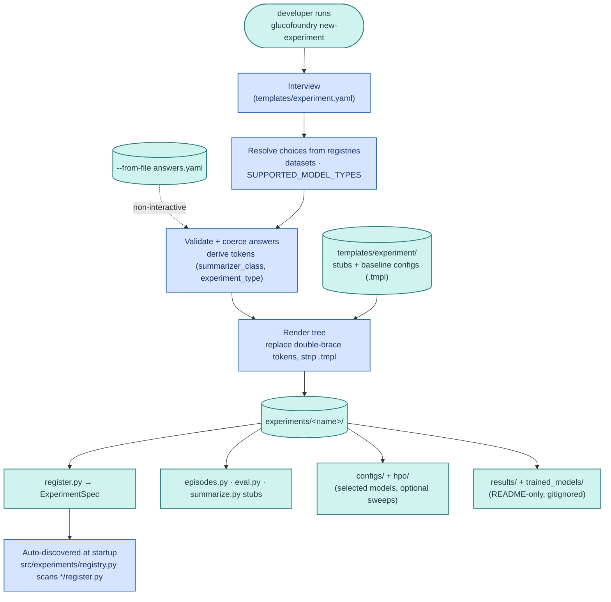
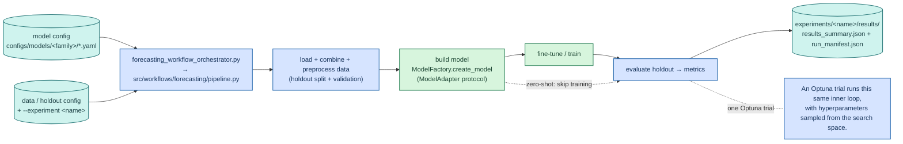
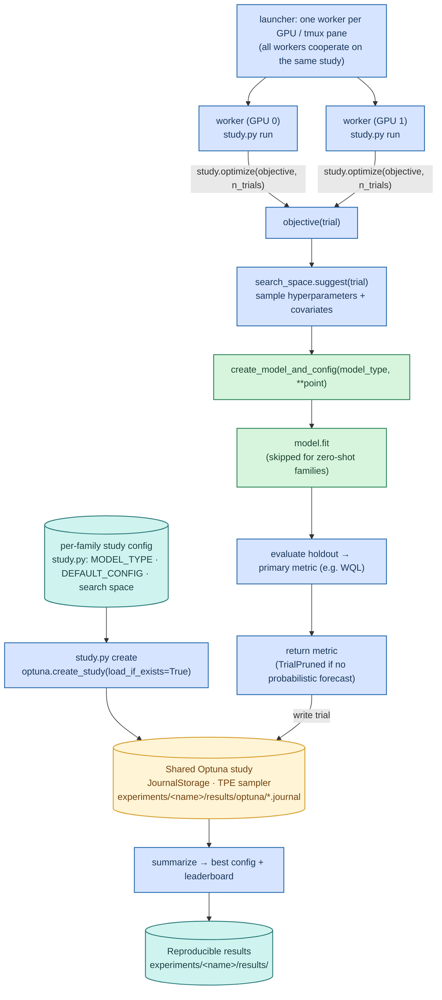

# Research workflows

GlucoFoundry's research loop is three **nested** workflows. From the outside in:

1. **Scaffold a new experiment** — `glucofoundry new-experiment` renders a
   self-contained recipe under `experiments/<name>/`.
2. **Single-model training & evaluation** — the generic forecasting pipeline
   trains one model with one config and scores it on a holdout.
3. **Optuna sweep** — a hyperparameter search that runs the single-model loop
   once per trial and keeps the best configuration.

The diagrams below are published here from their Mermaid sources in
`agent_notes/diagrams/` (`*.mmd`), which remain the editable source-of-truth.
They describe the **experiment-agnostic** toolkit flow; the shipped
`experiments/nocturnal/` recipe is used only as a concrete example.

## Legend

The three diagrams share one visual language. **Colour** encodes a node's
*role*; **shape** encodes its *kind*; **edge style** encodes whether a step is
always taken.

| Encoding | Meaning |
|---|---|
| Teal fill | inputs, outputs, and on-disk artifacts |
| Blue fill | an experiment-agnostic toolkit step (`src/` code) |
| Green fill | the model-adapter layer — build / train / fine-tune / evaluate a model |
| Amber fill | persistent shared state (the Optuna study) |
| Stadium `([ ])` | a human action or CLI entrypoint |
| Rectangle `[ ]` | a process step (code) |
| Cylinder `[( )]` | data, a config file, or a stored artifact / database |
| **Solid** arrow → | the primary, always-taken flow |
| **Dashed** arrow ⇢ | an optional or conditional path |

The fill colours above are shown live in the mermaid key; not every diagram uses
every colour — scaffolding, for example, never builds a model, so it has no green
nodes.

## 1. Scaffolding a new experiment

`glucofoundry new-experiment` (see
[`src/cli/new_experiment.py`](/src/cli/new_experiment.py)) drives the interview
declared in [`templates/experiment.yaml`](/templates/experiment.yaml), then
renders [`templates/experiment/`](/templates/experiment) into a new
`experiments/<name>/` recipe that the registry auto-discovers.

- The interview questions and their valid choices come from
  `templates/experiment.yaml`; dataset and model options are resolved **at run
  time** from the registries (`list_available_datasets` and
  [`SUPPORTED_MODEL_TYPES`](/src/models/factory.py)) so the manifest never goes
  stale.
- `--from-file answers.yaml` runs the same validation non-interactively.
- A few tokens are **derived**, not asked (`summarizer_class`,
  `experiment_type`).
- Rendering copies the template tree, substitutes `{{ token }}` placeholders, and
  strips the `.tmpl` suffix. `results/` and `trained_models/` ship as
  README-only directories (everything else under them is gitignored).
- The recipe's `register.py` is picked up by
  [`src/experiments/registry.py`](/src/experiments/registry.py), which scans
  `experiments/*/register.py` at startup — so dropping a directory cleanly adds
  or removes an experiment.

## 2. Single-model training & evaluation

This is the generic forecasting pipeline: one model config + one data/holdout
config in, metrics out. The orchestrator
([`scripts/workflows/forecasting/forecasting_workflow_orchestrator.py`](/scripts/workflows/forecasting/forecasting_workflow_orchestrator.py))
is a thin wrapper over
[`src/workflows/forecasting/pipeline.py`](/src/workflows/forecasting/pipeline.py),
which runs a fixed multi-step sequence (holdout checks → load/preprocess → build
→ train → evaluate).

- Every model is built through the model-adapter layer
  ([`ModelAdapter`](/src/models/adapter.py) protocol, via `ModelFactory` /
  [`create_model_and_config`](/src/workflows/forecasting/modeling.py)), so the
  pipeline is model-family-agnostic.
- **Zero-shot** foundation families (`supports_zero_shot = True`) skip training
  and go straight to evaluation — the dashed path.
- Evaluation writes the canonical `run_manifest.json`
  ([`src/workflows/runtime/manifest.py`](/src/workflows/runtime/manifest.py)) and
  `results_summary.json`
  ([`src/evaluation/storage.py`](/src/evaluation/storage.py)) under the
  experiment's own `results/`.
- This inner loop is exactly what one Optuna trial runs (next section).

## 3. Optuna sweep

A sweep is a shared Optuna study plus one or more cooperating workers. Each
family's `study.py` defines `MODEL_TYPE`, a `DEFAULT_CONFIG`, and a search space;
workers run `study.optimize`, and every trial executes the single-model loop
above with hyperparameters sampled from the search space. The reusable engine is
[`src/workflows/hpo/engine.py`](/src/workflows/hpo/engine.py); the per-experiment
sweep tree lives under `experiments/<name>/hpo/<family>/`.

- Storage is an Optuna **`JournalStorage`** file under the experiment's own
  `results/optuna/` (not a central RDB), so independent workers cooperate on one
  study and experiments never collide. Sampling uses the Optuna default **TPE**
  sampler.
- The launcher starts **one worker per GPU / tmux pane**; each worker calls
  `study.optimize` on the shared study. (Launcher ergonomics are
  experiment-owned — e.g. `experiments/nocturnal/scripts/sweeps/optuna/`.)
- `search_space.suggest(trial)` samples the model kwargs (and covariate columns);
  `create_model_and_config` + `model.fit` + `evaluate` is the **same inner loop**
  as the single-model workflow above.
- A trial is **pruned** only as a guard — when a model cannot produce the
  probabilistic forecast the primary metric needs — not via intermediate-value
  reporting.
- The experiment's summarizer turns completed trials into the best config and a
  leaderboard under `results/`.
