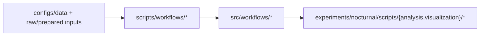

# Example Scripts Guide

This guide lists the maintained scripts in `scripts/examples/`,
`scripts/workflows/`, and `scripts/orchestration/` and when to use each one.

## Active examples

| Script | Purpose | Typical use |
|---|---|---|
| `example_forecasting_workflow.py` | Thin onboarding entrypoint for generic forecasting workflow | Quick walkthrough and CLI discovery |
| `forecasting_workflow_orchestrator.py` (`scripts/workflows/forecasting/`) | Production CLI entrypoint for generic forecasting workflow | Stable runtime surface for wrappers and automation |
| `run_forecasting_workflow.sh` (`scripts/workflows/forecasting/`) | Local shell wrapper for the production orchestrator | Repeatable local runs with environment variables |
| `forecasting_workflow_regression_smoke.sh` (`scripts/workflows/forecasting/`) | Deterministic bounded regression profile | Major-change workflow smoke/regression runs |
| `example_data_holdout_system.py` | Demonstrates holdout config generation/validation/loading APIs | Data split and holdout debugging |
| `example_load_holdout_data.py` | Minimal holdout loading example | Quick data-access sanity checks |

## Model-specific experiment scripts

Model-specific one-off experiment scripts were retired from the maintained
toolkit surface. Reproduce model-specific workflows via the canonical entrypoints
(the forecasting pipeline and the Python-first sweep framework) described below.

## Sweep orchestration (Optuna)

Hyperparameter sweeps run through per-model-family **Optuna** studies in
[`src/workflows/sweeps/`](/src/workflows/sweeps) (for example
`src/workflows/sweeps/optuna_chronos2/study.py`). The earlier hand-rolled shell
sweep harness was removed in favor of this Optuna-based orchestration.

The nocturnal experiment drives its Optuna runs from
[`experiments/nocturnal/scripts/sweeps/optuna/`](/experiments/nocturnal/scripts/sweeps/optuna)
(launcher + feature-cache prebuild), seeded by
`experiments/nocturnal/configs/chronos2_optuna_poc.yaml`.

## Canonical workflow example

Use the production orchestrator as the default entrypoint for training runs:

```bash
python scripts/workflows/forecasting/forecasting_workflow_orchestrator.py \
  --model-type chronos2 \
  --datasets brown_2019 lynch_2022 \
  --config-dir configs/data/holdout_10pct
```

Use the onboarding example wrapper for quick discovery:

```bash
python scripts/examples/example_forecasting_workflow.py --help
```

Or use the local shell wrapper:

```bash
MODEL_TYPE=chronos2 \
DATASETS="brown_2019 lynch_2022" \
CONFIG_DIR="configs/data/holdout_10pct" \
bash scripts/workflows/forecasting/run_forecasting_workflow.sh
```

Regression profile (bounded end-to-end guardrail):

```bash
bash scripts/workflows/forecasting/forecasting_workflow_regression_smoke.sh
```

## Taxonomy flow (Wave 1)



Shared visualization helpers for retained nocturnal plotting scripts now live in
[`src/visualization/nocturnal.py`](/src/visualization/nocturnal.py).

Visualization script purposes, duplication assessment, and curated example
outputs are documented in
[`docs/user-guide/modeling/visualization-guide.md`](/docs/user-guide/modeling/visualization-guide.md).

## Canonical run manifest (v1)

The maintained forecasting training workflow and nocturnal evaluation workflow now
emit a canonical run manifest at:

- `<workflow_output_dir>/run_manifest.json`

This includes the ratified v1 fields from the design handbook:

- identity (`run_id`, `workflow_name`, `workflow_version`)
- timing (`created_at_utc`, `started_at_utc`, `ended_at_utc`, `duration_seconds`)
- code provenance (`git_commit`, `git_branch`, `git_dirty`, `repository`)
- execution context (`launcher_type`, `host`, `user`, `python_version`, CUDA/SLURM context)
- inputs (data/model config paths + resolved runtime config)
- outputs (artifact root + checkpoint/prediction/plot paths)
- result summary (`key_metrics`, `status`, `failure_message`)

## Notes on legacy examples

Several older example scripts were removed during P1 scripts cleanup because they
depended on model-base surfaces that were already pruned from runtime. If you need
the old behavior, use git history for reference and prefer rebuilding on top of
the maintained scripts listed above.

## Generic visualization entrypoints

Visualization entrypoints use generic plotting contracts and live with the
experiment that produces their inputs:

- [`plot_probabilistic_forecast_grid.py`](/experiments/nocturnal/scripts/visualization/plot_probabilistic_forecast_grid.py)
- [`plot_forecast_episode_overlays.py`](/experiments/nocturnal/scripts/visualization/plot_forecast_episode_overlays.py)

Each script documents its required input data format at the top of the file.
